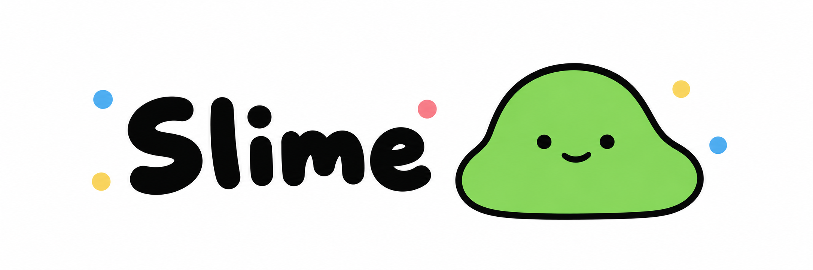

<p align="center">
  
</p>

<p align="center">
  <a href="README.md">English →</a>
</p>

macOS 窗口切换器。比系统自带的切换器多两样东西：**打字即时搜索**和**双触发手势**。

> **开发版本：0.0.7。** 可选面板背景主题，以及带 slime 标识的搜索栏。最新已发布 DMG 仍为 0.0.6。

## 安装 DMG

需要 **macOS 26 或更新版本**。本轮发行包面向 **Apple silicon（arm64）**；Intel 可从源码构建，但本轮不提供已验证的 Intel 安装包。

1. 从 [GitHub Releases](https://github.com/chriscco/slime/releases) 下载 DMG 和对应的 `.sha256` 文件。
2. 在下载目录运行 `shasum -a 256 -c slime-0.0.6-arm64.dmg.sha256` 校验文件。
3. 打开 DMG，将 slime 拖到 Applications，推出磁盘映像，再从应用程序打开 slime。

**0.0.6 使用本地自签证书，未经 Apple 公证。** 如果 macOS 因无法验证开发者而阻止打开，确认文件来自本仓库且校验通过后，在“系统设置 → 隐私与安全性”中对 slime 选择“仍要打开”，再确认系统提示。无需全局关闭 Gatekeeper。参见 [Apple 的首次打开说明](https://support.apple.com/en-ie/102445)。

## 手势

| 按键 | 行为 |
|---|---|
| 按住 `⌘`，连按 `Tab` | 循环切换窗口。**松开 `⌘` 就切过去** —— 手感跟系统原生的切换器一致。 |
| 按住 `⌥`，连按 `Tab` | 同一个面板，但**松手后面板留住**。可以直接打字搜索，按回车才切。 |
| `⌘F` | 聚焦搜索框。两种模式下都可用。 |
| `Tab` / `⇧Tab` | 选中往前 / 往后移。高亮条在项之间平滑滑动。 |
| `↑` `↓` `←` `→` | 移动选中。 |
| 直接打字 | 实时模糊过滤 —— `ghb` 能命中 `Chrome — GitHub`。 |
| `Enter` | 切到选中项。**最小化的窗口也能切过去。** |
| `⌘D` | 关闭选中窗口并播放 CRT 预览动画，不退出应用。 |
| `⌘,` | 打开设置；松开 Option 后仍可使用。 |
| `Esc` | 关闭面板，且不改变当前窗口。 |

列表按应用级 MRU 排序，包含当前窗口并将其放在末尾；开启分组后每个应用独立分区。固定每行五张，少于五张时面板宽度不缩小。同行下划线平滑移动，跨行直接定位。

slime 没有 Dock 图标，也不会出现在系统原生的 `⌘+Tab` 列表里。你不叫它，它就不出现。

它按**窗口而非 app**显示条目，让你直接跳到目标。公开系统 API 无法可靠发现或操作所有离屏窗口，限制见下文。

## 设置

从菜单栏或面板内 `⌘,` 打开。通用包含总开关、应用分组、登录启动和 English / 简体中文；
默认英文。0.0.6 首次启动将旧高亮色一次性改为史莱姆绿 `#96D76A`（RGB 150, 215, 106），随后自定义颜色会保留；玻璃偏好不变。外观页提供黑色（默认）、白色、深蓝（`#0A2C37`）和跟随系统四种背景，并用可点击的迷你面板展示主题。跟随系统会响应 macOS 明暗模式。玻璃样式、强度、高亮色和面板圆角仍可调整；完全透明时不显示底色，预览展示不透明主题。
快捷键页展示固定绑定；关于页显示实际版本及仓库链接。

关闭总开关立即恢复系统 `⌘Tab`，菜单栏入口保留。登录启动读取 macOS 实际状态，可能需要在系统设置批准。

`⌘D` 仅请求关闭选中窗口，不退出应用，也不代替用户回应保存确认。关闭开始时，选中底色、标题和短线淡出，仅预览播放 CRT；直接关闭失败则恢复。成功减少行数时面板平滑缩高。开启“减少动态效果”后使用淡出并取消移动动画。

无法直接访问目标时，slime 会尝试唤起目标应用并重新核验窗口；此时面板退出，关闭或确认后不会自动返回。无法唯一确定目标时不会猜测关闭。自动识别、重试和确认共享三秒预算；系统 AX 调用可能迟于请求的超时返回。

`⌘Tab` 后开始打字即进入常驻搜索，松开 Command 不会切走，无需先按 `⌘F`；未打字时仍保持松手切换。搜索框左侧显示圆角 slime 图标；未聚焦时右侧显示无独立底色的 `⌘F` 提示，聚焦或打字后隐藏，关闭状态信息优先显示。搜索焦点用带淡淡中性轮廓的 2pt 高亮边框和末尾光标表示，光标直接定位，不再平滑移动。打字追加查询，Backspace 删除末尾字符；方向键仍用于选窗口。此版本不提供文本选择、任意光标定位或输入法组字。

## 系统要求

- **macOS 26+**，面板使用 `NSGlassEffectView`。
- **屏幕录制权限**用于预览。没有有效预览或同窗口缓存时，显示带应用图标的通用小窗口占位。
- **需要辅助功能权限。** slime 通过辅助功能 API 读窗口列表，并且要拦截你按下的
  按键，所以必须由 macOS 授权。
- **零第三方依赖。**

## 构建与运行

不需要 Xcode，命令行工具够了。

```sh
scripts/setup-signing     # 只跑一次；让辅助功能权限扛得住 rebuild
scripts/build-app         # 生成 build/slime.app
open build/slime.app
```

`scripts/build-app` 是手工拼 `.app` bundle 的（`swift build` + 生成 `Info.plist`），
不走 Xcode 工程。要 release 构建就 `CONFIG=release scripts/build-app`。

### `setup-signing` 为什么不是可选项

只跑一次，但这十分钟值得花。

macOS 把辅助功能授权绑定在 app 的**代码签名身份**上。ad-hoc 签名（`codesign -s -`）
的 designated requirement 只有一个 cdhash，于是**每次重新编译哈希都变，你必须手工
重新去系统设置里勾一遍权限**。换成自签证书，DR 锚定的是证书身份，证书不变 DR 就不变，
rebuild 不会掉权限。跳过这一步，你一天要勾几十次那个复选框。

## 首次运行

1. slime 会申请辅助功能权限，弹出系统对话框。
2. 在**系统设置 → 隐私与安全性 → 辅助功能**里把 slime 打开。
3. **退出 slime 再重新打开。** 权限只对新启动的进程生效 —— 每个人都会在这里
   踩一次坑。

如果 slime 装不上事件监听，它会报错并关闭接管，菜单栏设置仍可使用。授权后重启并在设置中重新启用。如果运行中
macOS 把 tap 禁掉了，slime 会停止拦截、退回系统原生 `⌘+Tab` —— **宁可切换器
失效，也不能让用户的键盘坏掉。**

## 打包发行版

```sh
scripts/package-dmg
```

脚本执行 release 构建，按实际架构命名 DMG，并只读挂载验证版本、签名、图标、二进制和 Applications 链接，最后生成 SHA-256 校验文件。产物位于 `build/`。本地自签名用于稳定开发权限，不等于 Developer ID 签名或 Apple 公证。

## 已知限制

公开 AX 信息可能只覆盖部分 Space；从未观察过的窗口可能暂缺，歧义目标会拒绝关闭。跨 Space 缓存预览可能过期；从应用自身关闭且系统保留表面的窗口可能延迟清理。安全输入开启时使用系统切换器。面板打开期间，未专门绑定的 Command 字母组合仍作为过滤输入。登录启动和权限行为需按本机系统提示确认。

## 测试

```sh
scripts/test
```

用 [swift-testing](https://github.com/swiftlang/swift-testing)（`import Testing`，
不是 XCTest）。`Tests/slimeTests/` 覆盖 Core 纯逻辑、AppKit 控件和异步生命周期。
触发状态机测试穷举按键吞放；实际系统行为仍需真机验收。

`scripts/benchmark` 测量 release 构建下 10/50/100 个窗口的查询、布局和离屏绘制 CPU 耗时，
不代表输入到屏幕显示的延迟，详见[验证记录](docs/releases/0.0.6-validation.md)。

## 目录结构

```text
slime/
├── Package.swift
├── Resources/
│   ├── slime.png
│   └── slime.icns
├── Sources/slime/
│   ├── App/
│   ├── Core/
│   ├── System/
│   └── UI/
├── Tests/slimeTests/
├── docs/
│   ├── specs/
│   ├── plans/
│   ├── modules/
│   ├── releases/
│   └── templates/
├── scripts/
│   ├── build-app
│   ├── package-dmg
│   ├── benchmark
│   ├── fixtures/
│   ├── test
│   ├── setup-signing
│   └── hooks/
└── .github/workflows/
    └── test.yml
```

`Core/` 刻意不能 import AppKit、CoreGraphics、ApplicationServices。
纯状态/布局测试不依赖系统权限；另有 AppKit 控件及异步生命周期测试。真实 AX、登录项和动画观感仍需原生验收。

## 参与开发

所有变更走 **issue → 分支 → PR → merge**。禁止直接提交到 `main`，
pre-commit 钩子会拦。

- 分支：`feat/` `fix/` `docs/` `chore/`
- 提交标题：`类型(范围): 做了什么`，例如
  `fix(panel): keep the selection when the list refreshes`
- PR 必须写清**为什么**，不只是改了什么，并且必须关联 issue。只有把 issue 的
  交付物**做完了**才写 `Closes #N`，只完成一部分写 `Refs #N` —— 用错 `Closes`
  会把没做完的 issue 关掉，比不关更糟。

完整的开发规范在 [`CLAUDE.md`](CLAUDE.md)（英文）。动 `EventTap` 或 `WindowEnumerator`
之前先读它 —— 里面写了这个领域的正确性红线，踩错不是「看起来不好」，是会把
用户的机器弄坏。

## 文档

| 路径 | 内容 |
|---|---|
| [`docs/specs/`](docs/specs/) | 每个版本要做什么 |
| [`docs/modules/`](docs/modules/) | 分模块的设计、取舍、交接 |

## 许可证

本项目采用 [MIT 许可证](LICENSE)。
